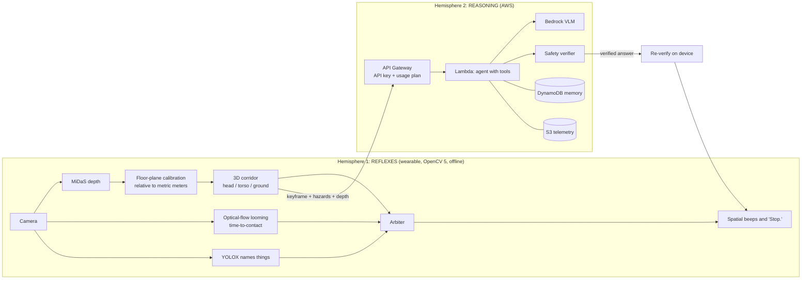

<div align="center">

# UnCane-y AI

### An active-safety and assistive-navigation co-pilot for blind and low-vision people

**Reflexes on the device. Reasoning in the cloud. Every answer verified before it is spoken.**


*OpenCV AI Competition 2026, powered by AWS (Use Case 3)*

</div>

---

## Why this exists

A white cane finds what is at ground level, close to the user. It misses what is **above the
waist** (a low branch, a truck mirror, a shelf corner) and what is **fast and silent** (an
e-scooter, a bike). Existing assistive apps describe a scene well but are slow, need a network,
and can confidently say "the path is clear" when it is not.

UnCane-y AI splits the problem into two parts, the way a person's nervous system does:

| | Hemisphere 1: **Reflexes** | Hemisphere 2: **Reasoning** |
|---|---|---|
| Runs | On the wearable, every frame | In AWS, on request |
| Needs network | **No** | Yes (degrades gracefully without it) |
| Speed | p50 **47 ms** per frame (laptop CPU) | Target under 1.5 s |
| Does | Depth, 3D walking corridor, time-to-contact, object names, spatial beeps and "Stop." | Answers *"Where is the red water bottle?"*, *"What does that sign say?"*, remembers places |
| Tech | OpenCV 5 DNN, MiDaS, YOLOX, optical flow | Amazon Bedrock (Claude), API Gateway, Lambda, DynamoDB, S3 |

The key safety idea: **the cloud model is never trusted on safety.** A deterministic verifier
checks every cloud answer against the device's own depth sensing. If the camera sees an obstacle,
"the path is clear" cannot be spoken, on the server or on the device.

## Highlights

- **Sub-50 ms obstacle warnings with no network.** Metric depth from a single RGB camera.
- **Head-height awareness.** A 3D corridor split into head, torso and ground zones, so branches and signs are caught as well as boxes.
- **Approaching-object detection.** Optical-flow looming gives time-to-contact for fast things the cane never touches. Slow approaches are ignored to avoid false alarms.
- **Calm, spatial audio.** Stereo beeps pan left and right and speed up as you get closer. Speech is rate-limited and debounced.
- **Natural-language help.** Ask about objects, text and surroundings. The answer starts with a deterministic turn instruction, such as "Turn 15 degrees right, walk four steps."
- **Anti-hallucination verifier.** Cloud answers are grounded with edge depth and overridden if they contradict what the device sees.
- **Graceful degradation.** Cloud down? The device keeps protecting the user and says so.
- **Deployable in one command.** AWS SAM template for API Gateway, Lambda, DynamoDB, S3, CloudWatch dashboard and alarms.
- **Fully testable offline.** 42 tests run in about 2 seconds with no camera, no models and no AWS account.

## How it works



The full algorithm descriptions, JSON contracts, safety rules and latency budget are in
[docs/ARCHITECTURE.md](docs/ARCHITECTURE.md).

## Measured results

| Metric | Result | How to reproduce |
|---|---|---|
| Edge reflex loop (depth + corridor + flow) | **p50 47 ms, p95 53 ms** on a laptop CPU (OpenCV 5.0.0, 128 px input) | `pytest -m latency -s` |
| Time-to-contact accuracy | 1.13 s true, 1.18 s detected; 0.68 s true, 0.68 s detected; slow 4 s approaches correctly ignored | `tests/test_optical_flow.py` |
| Floor calibration (relative to metric depth) | Under 5 % median error on floor pixels, synthetic scenes | `tests/test_geometry_hazards.py` |
| Detector (YOLOX-S, 416 px) | mAP@[.5:.95] **0.349**, mAP@.5 **0.467** on a 60-image COCO navigation subset; 96 ms | `eval/eval_detector_coco.py` |
| Anti-hallucination | "Path is clear" overridden when the edge sees an obstacle, in Lambda and again on the device | `tests/test_verifier.py`, `tests/test_cloud_handler.py`, `scripts/smoke_test_api.py` |
| Cloud latency (target under 1.5 s), VizWiz accuracy | **Not yet measured.** Needs a deployed stack with Bedrock access | CloudWatch dashboard, `eval/eval_vizwiz_vlm.py` |

These numbers come from a laptop and synthetic or small-subset data. They are not a clinical
or field validation.

---

## Table of contents

1. [Quick start](#quick-start-10-minutes-no-aws-needed)
2. [Requirements](#requirements)
3. [Installation in detail](#installation-in-detail)
4. [Running the app](#running-the-app)
5. [Calibrate for your body and camera](#calibrate-for-your-body-and-camera)
6. [Deploy the cloud tier on AWS](#deploy-the-cloud-tier-on-aws)
7. [Configuration reference](#configuration-reference)
8. [Testing and evaluation](#testing-and-evaluation)
9. [Hardware options](#hardware-options)
10. [Project layout](#project-layout)
11. [Troubleshooting](#troubleshooting)
12. [Documentation index](#documentation-index)
13. [Safety notice](#safety-notice)
14. [License](#license)

---

## Quick start (10 minutes, no AWS needed)

All commands run from the `uncane/` folder.

```bash
git clone https://github.com/yadavmanan/opencv-uncane.git
cd opencv-uncane/uncane

python -m venv .venv
source .venv/bin/activate              # Windows PowerShell: .venv\Scripts\Activate.ps1
pip install -r requirements-dev.txt
pip install -e .

python scripts/download_models.py      # MiDaS depth + YOLOX detector, about 100 MB
pytest                                 # 42 tests, about 2 s
```

Run the edge app with no cloud at all (reflexes only):

```bash
python -m uncane.edge.app --set cloud.enabled=false
```

Or run both tiers on your machine, with a mock VLM standing in for Bedrock:

```bash
# terminal 1: the cloud tier locally
VLM_BACKEND=mock python -m uncane.cloud.local_server

# terminal 2: the wearable runtime on your webcam
UNCANE_API_URL=http://127.0.0.1:8787 UNCANE_API_KEY=local python -m uncane.edge.app
```

<details>
<summary>PowerShell equivalents</summary>

```powershell
# terminal 1
$env:VLM_BACKEND = "mock"; python -m uncane.cloud.local_server

# terminal 2
$env:UNCANE_API_URL = "http://127.0.0.1:8787"; $env:UNCANE_API_KEY = "local"
python -m uncane.edge.app
```

</details>

Walk slowly toward a chair with the camera at chest height. The beeps speed up, and at about
1.2 m you hear "Stop. Chair ahead." Press `1` to ask where the water bottle is.

## Requirements

| Need | Details |
|---|---|
| Python | 3.10 or newer |
| Git | To clone the repo |
| Camera | Laptop webcam for development. A USB webcam on a chest strap, or a phone streaming video, for real use |
| Headphones | Stereo is required, because beeps are panned left and right. Bone-conduction headphones keep the ears open to traffic |
| Disk | About 400 MB for models |
| AWS (optional) | An account with Amazon Bedrock model access, AWS CLI and AWS SAM CLI. Only for the cloud tier |
| GPU (optional) | NVIDIA Jetson Orin or a CUDA laptop, for larger depth models |

Linux notes: `sounddevice` needs PortAudio (`sudo apt install libportaudio2`) and `pyttsx3`
needs eSpeak (`sudo apt install espeak-ng`). On a board without a display, use
`opencv-python-headless` and run with `--headless`.

## Installation in detail

```bash
pip install -r requirements-dev.txt   # edge runtime + cloud tier + test tools
pip install -e .                      # makes `uncane` importable and adds the CLI commands
```

A production wearable only needs `requirements-edge.txt`.

Optional extras, installed with `pip install -e ".[extra]"`:

| Extra | Adds |
|---|---|
| `audio` | `sounddevice`, `pyttsx3` for beeps and speech |
| `voice` | `vosk` for offline push-to-talk questions |
| `haptics` | `pyserial` for a vibration belt or vest |
| `ort` | `onnxruntime` backend for small boards |
| `cloud` | `anthropic[bedrock]`, `boto3` |
| `data` | `pycocotools`, `tqdm` for the evaluation scripts |

Models:

```bash
python scripts/download_models.py          # required: MiDaS small (67 MB) + YOLOX-S (36 MB)
python scripts/download_models.py --all    # also Depth-Anything-V2 small and Vosk speech
```

| Model | Purpose | License |
|---|---|---|
| MiDaS v2.1 small | Monocular depth (default) | MIT |
| YOLOX-S (OpenCV Zoo) | COCO object names | Apache-2.0 |
| Depth-Anything-V2 small | Sharper depth, for GPU devices | Apache-2.0 |
| Vosk small en-US | Offline voice questions | Apache-2.0 |

## Running the app

```bash
python -m uncane.edge.app                                  # live camera
python -m uncane.edge.app --source path/to/walk.mp4        # a recorded video (loops)
python -m uncane.edge.app --headless --frames 300          # no windows; prints latency at the end
python -m uncane.edge.app --set depth.input_size=192 --set detector.hz=1
```

Two windows open: the camera feed (latency, depth status, cloud status, hazards, detector
boxes, red dots on looming points) and the depth map.

| Key | Action |
|---|---|
| `1` to `4` | Preset questions (need the cloud; offline you get the on-device answer) |
| `v` | Push-to-talk (Vosk backend) |
| `c` | Restart floor calibration |
| `q` / `Esc` | Quit |

You can also type a question into the terminal and press Enter. Voice input and haptics are
covered in [docs/SETUP.md](docs/SETUP.md).

## Calibrate for your body and camera

Metric distances come from floor-plane geometry, so three numbers in
[uncane/config/edge_config.yaml](uncane/config/edge_config.yaml) must be right:

| Setting | Meaning | Typical value |
|---|---|---|
| `camera.hfov_deg` | Camera horizontal field of view | 60 to 78 degrees for webcams |
| `mount.height_m` | Lens height above the floor | 1.2 to 1.4 m on a chest strap |
| `mount.pitch_deg` | Downward tilt | 10 to 15 degrees |

Also set `mount.user_height_m` (top of the head), which bounds head-level hazards.

**Check it:** in an open corridor, wait for the status to read `depth metric`, then place a box
1.5 m ahead. You should see "WARNING box directly ahead at ground level, about 1.5 meters",
give or take 20 %. If distances are consistently off, adjust `pitch_deg` first, then
`height_m`. The full procedure, including how to measure the field of view, is in
[docs/SETUP.md](docs/SETUP.md).

## Deploy the cloud tier on AWS

The cloud tier is one SAM stack: API Gateway (API key and usage plan), a Lambda agent, a
DynamoDB session table, an S3 telemetry bucket, and a CloudWatch dashboard with alarms.

```bash
cd uncane
aws configure                              # or use SSO / environment credentials
sam build
sam deploy --guided                        # accept the defaults to start
```

After deploy, the stack outputs `ApiUrl`. Get the API key and point the edge app at it:

```bash
aws apigateway get-api-keys --include-values        # copy the key value

export UNCANE_API_URL=https://<id>.execute-api.<region>.amazonaws.com/prod
export UNCANE_API_KEY=<your key>
python scripts/smoke_test_api.py --image tests/data/sample_indoor.jpg --query "What is in front of me?"
python -m uncane.edge.app
```

The smoke test also sends a fake critical obstacle and confirms the reply is **not** "the path
is clear".

Useful stack parameters (see [uncane/template.yaml](uncane/template.yaml)):

| Parameter | Default | Purpose |
|---|---|---|
| `ModelId` | `anthropic.claude-sonnet-5` | Bedrock model used by the agent |
| `VlmBackend` | `bedrock` | `bedrock`, `mantle` (open VLM, API key), `sagemaker`, or `mock` |
| `BedrockRegion` | stack region | Region for Bedrock calls |
| `Effort` | `low` | Reasoning effort, trades latency for depth |
| `DailyRequestQuota` | `5000` | API usage-plan cap |
| `SaveKeyframes` | `false` | Store uploaded keyframes in S3 (off by default for privacy) |
| `AlarmEmail` | empty | Email for CloudWatch alarm notifications |

Full walkthrough (Bedrock model access, security, cost, monitoring, SageMaker fine-tuning,
teardown): [docs/AWS_SETUP.md](docs/AWS_SETUP.md). To delete everything: `sam delete`.

> The committed [uncane/samconfig.toml](uncane/samconfig.toml) holds sample deploy defaults.
> `sam deploy --guided` lets you override them. Never commit API keys.

## Configuration reference

Edge behavior is set in [uncane/config/edge_config.yaml](uncane/config/edge_config.yaml) and can
be overridden on the command line with `--set key=value`.

| Key | Default | Effect |
|---|---|---|
| `depth.input_size` | 128 | Bigger is sharper and slower (about 32 ms at 128, 48 ms at 160) |
| `hazards.critical_m` / `critical_head_m` | 1.2 / 1.6 | Distance at which "Stop" fires |
| `hazards.corridor_half_width_m` | 0.40 | Body half-width plus margin |
| `flow.ttc_warning_s` / `ttc_critical_s` | 3.0 / 1.5 | Approaching-object thresholds |
| `arbiter.confirm_frames` / `window` | 2 / 3 | Debounce: more for fewer false alarms |
| `arbiter.speech_cooldown_s` | 4 | Minimum gap between repeated spoken warnings |
| `detector.hz` / `input_size` | 2 / 416 | Lower both if the loop exceeds 50 ms on CPU |
| `keyframes.max_side_px` / `jpeg_quality` | 768 / 80 | Upload size, which drives cost and latency |
| `cloud.ambient_mode` | false | Proactively describe signs and doors when the scene changes |

Environment variables:

| Variable | Used by | Meaning |
|---|---|---|
| `UNCANE_API_URL` | Edge | Cloud API base URL, including the `/prod` stage |
| `UNCANE_API_KEY` | Edge | API Gateway key |
| `VLM_BACKEND` | Cloud | `bedrock`, `mantle`, `sagemaker` or `mock` |
| `MODEL_ID` / `AWS_REGION` | Cloud | Bedrock model and region when running the local server |
| `UNCANE_LATENCY_BUDGET_MS` | Tests | Latency budget for `pytest -m latency` |

The complete tuning table is in [docs/SETUP.md](docs/SETUP.md).

## Testing and evaluation

```bash
pytest                      # 42 offline tests: verifier, geometry, flow, arbiter, Lambda handler, agent loop
pytest -m latency -s        # reflex-loop benchmark on the real model; asserts p50 under 50 ms
pytest -m live              # calls real AWS services (costs money, opt-in)
```

Evaluation scripts (need the `data` extra and the datasets):

| Script | Measures |
|---|---|
| `scripts/prepare_coco_subset.py` then `eval/eval_detector_coco.py` | Detector mAP on a COCO navigation subset |
| `scripts/prepare_vizwiz.py` then `eval/eval_vizwiz_vlm.py` | VLM accuracy on VizWiz photos from blind users, including whether it correctly says "I can't tell, re-aim the camera" |
| `training/sagemaker/` | Optional LoRA fine-tune of an open VLM on VizWiz and endpoint deployment |

Datasets are not stored in this repo. See [docs/DATA_AND_TRAINING.md](docs/DATA_AND_TRAINING.md)
for how to download them and interpret the metrics.

## Hardware options

| Setup | Notes |
|---|---|
| Laptop in a backpack + USB chest camera | The simplest robust option |
| Phone as the camera | Use an IP-camera app and set `camera.source: "http://<phone-ip>:8080/video"`. Adds 50 to 150 ms |
| NVIDIA Jetson Orin Nano | Build OpenCV 5 with CUDA, set `depth.opencv_target: cuda` and `depth.input_size: 256` |
| Raspberry Pi 5 | Headless, `depth.input_size: 128`, detector off or 1 Hz. Expect 100 to 150 ms per frame |
| Haptic belt or vest | Any microcontroller reading `L,C,R\n` (0 to 255 each, 115200 baud) driving three motors |

## Project layout

```
opencv-uncane/
├── README.md                 this guide
├── LICENSE                   MIT
├── docs/                     setup, architecture, AWS, data, demo, product and submission docs
└── uncane/                   the runnable project (run every command from here)
    ├── pyproject.toml            package metadata and pytest config
    ├── requirements-dev.txt      edge + cloud + test dependencies
    ├── requirements-edge.txt     minimal wearable dependencies
    ├── template.yaml             AWS SAM: API Gateway, Lambda, DynamoDB, S3, CloudWatch
    ├── samconfig.toml            sample sam deploy defaults
    ├── config/edge_config.yaml   edge tuning (camera, mount geometry, thresholds, cloud URL)
    ├── src/uncane/
    │   ├── common/   schemas, spatial geometry, safety verifier, prompts (stdlib only, shared)
    │   ├── edge/     app, depth_engine, geometry, hazards, optical_flow, detector, arbiter,
    │   │             audio_feedback, voice_input, frame_filter, cloud_client, config
    │   └── cloud/    handler (Lambda), vlm (Bedrock/Mantle/SageMaker/mock), tools, memory,
    │                 telemetry, local_server
    ├── scripts/      download_models, prepare_vizwiz, prepare_coco_subset, smoke_test_api
    ├── eval/         eval_detector_coco, eval_vizwiz_vlm
    ├── training/sagemaker/   train_vizwiz_lora, launch_training, deploy_endpoint
    ├── models/       ONNX models (downloaded, not committed)
    └── tests/        42 offline tests + opt-in latency benchmark
```

## Troubleshooting

| Symptom | Fix |
|---|---|
| `ModuleNotFoundError: cv2` | Activate the venv and run `pip install -r requirements-dev.txt` from `uncane/` |
| `cannot open camera source 0` | Try `--source 1`, close other apps using the camera, grant camera permission on macOS |
| Status stuck on `calibrating` | Floor not visible: tilt the camera down (`mount.pitch_deg`) and check `mount.height_m` |
| Distances off by a constant factor | Wrong `hfov_deg` or `pitch_deg` |
| Constant beeping in open space | Floor misclassified: fix pitch or height, or raise `hazards.floor_tolerance_m` to 0.2 |
| Reflex p50 above 50 ms | Lower `depth.input_size`, set `detector.hz: 1`, close heavy apps |
| No sound | `python -c "import sounddevice; print(sounddevice.query_devices())"` |
| Cloud always `OFFLINE` | Check `UNCANE_API_URL` (must include `/prod`) and `UNCANE_API_KEY`; run `scripts/smoke_test_api.py` |
| HTTP 403 from the API | Missing or wrong API key |

More in [docs/SETUP.md](docs/SETUP.md) and [docs/AWS_SETUP.md](docs/AWS_SETUP.md).

## Documentation index

| Doc | For |
|---|---|
| [docs/SETUP.md](docs/SETUP.md) | Installing, calibrating the camera, running the edge app, hardware, tuning, troubleshooting |
| [docs/AWS_SETUP.md](docs/AWS_SETUP.md) | Everything on AWS: account, Bedrock access, deploy, API keys, monitoring, security, cost, SageMaker, teardown |
| [docs/ARCHITECTURE.md](docs/ARCHITECTURE.md) | Algorithms, contracts, safety rules, latency budget, graceful degradation |
| [docs/DATA_AND_TRAINING.md](docs/DATA_AND_TRAINING.md) | COCO and VizWiz pipelines, evaluation metrics, prompt-engineering loop, LoRA fine-tune |
| [docs/DEMO_RUNBOOK.md](docs/DEMO_RUNBOOK.md) | Stage demo checklist, script, recovery plans, user-study protocol |
| [docs/PRODUCT_AND_GO_TO_MARKET.md](docs/PRODUCT_AND_GO_TO_MARKET.md) | Product, customers, competition, business model |
| [docs/SUBMISSION.md](docs/SUBMISSION.md) | Competition technical report and evidence map |

## Safety notice

This is a research prototype built for a competition. It **does not replace** a white cane, a
guide dog, or orientation-and-mobility training. It must never be the only way a person judges
whether it is safe to cross a street, and the software is designed never to claim that. It has
not been validated with blind or low-vision users in the field.

## License

Released under the [MIT License](LICENSE).
