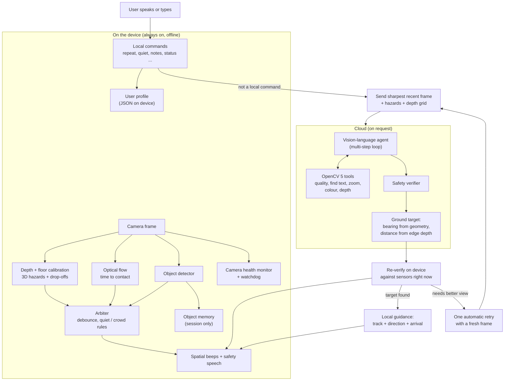

# UnCane-y AI: product overview and end-to-end workflow

What the product is, everything it does today, and how a request moves through it. Business and
market planning is in [PRODUCT_AND_GO_TO_MARKET.md](docs/PRODUCT_AND_GO_TO_MARKET.md). Setup is in
[SETUP.md](docs/SETUP.md), and the command list is in [NEW_FEATURES_GUIDE.md](docs/NEW_FEATURES_GUIDE.md).

> **Status.** Working research prototype. It is implemented and covered by offline tests, but it has
> not been validated with blind or low-vision users and it does not replace a white cane, a guide
> dog or orientation-and-mobility training. Items under "Known limits" below are not yet solved.

---

## 1. What it is

UnCane-y AI is a chest-worn assistive co-pilot for blind and low-vision people. A camera feeds two
cooperating systems:

- **Reflexes** run on the wearable, on every frame, with no network. They detect obstacles, head
  height hazards, drop-offs and approaching objects, and report them as spatial beeps and short
  spoken warnings.
- **Reasoning** runs in the cloud, on request. It answers questions such as "Where is the red water
  bottle?" or "What does this sign say?" using a vision-language model. The model is an agent: it
  can call OpenCV 5 tools on the photo (image quality, text finding, zoom, colour check, depth
  reading) and decides its next step from what they return.

A safety verifier sits between them. No cloud answer is spoken until it has been checked against
what the device's own depth sensor sees, so the assistant cannot say a path is clear when it is not.

All image analysis uses **OpenCV 5** (tested with 5.0.0.93). The edge app refuses to start on an
older build, and the cloud agent tools stay off unless OpenCV 5 is present. See section 6.

**One-line positioning:** the white cane tells you what is at your feet. UnCane tells you what is
coming, what is above you, and where things are.

---

## 2. Who uses it and when

| Situation | What the user does | What the product does |
|---|---|---|
| Walking down a corridor or street | Nothing | Beeps encode direction, height and distance. "Stop. Chair ahead." when close |
| A branch or sign at head height | Nothing | A distinct high tone and "Head height obstacle ahead. Duck or step aside." |
| A scooter or bike approaching | Nothing | "Bicycle coming, right!" with an urgent tone |
| A step down or kerb ahead | Nothing | "Drop-off ahead. Stop and check your footing." with a double-pulse tone |
| Looking for something | Asks "Where is my red water bottle?" | "Turn 30 degrees right, walk three steps. It is on the table." then on-device guidance until arrival |
| Reading something | Says "read the sign aloud" | The full visible text, spoken |
| Wants quiet, or is indoors | Says "quiet mode on" or "indoor mode" | Tones and distances adjust, and the choice is remembered |
| No signal | Nothing | Safety continues unchanged and the device says the cloud is unavailable |

---

## 3. End-to-end workflow

### Step by step

1. **Every frame.** The camera image goes through depth estimation. A floor-plane fit turns relative
   depth into metres. Points are placed in a 3D walking corridor split into left, centre and right,
   and ground, torso and head height. Optical flow estimates time to contact for moving objects, and
   a detector names what things are.
2. **Debounce.** The arbiter only alerts on a hazard seen in enough recent frames, and only
   sonifies the most urgent one so the user is not flooded. Drop-offs need a longer run of frames.
3. **Alert.** Position is conveyed with stereo beeps (pan is direction, pitch is height, rate is
   distance) and short spoken warnings for critical cases.
4. **A request.** The user speaks (Vosk offline speech recognition) or types. The device first checks
   whether it is a local command. If not, it sends the sharpest recent frame, current hazards and a
   coarse depth grid to the cloud.
5. **Reasoning (an agent loop).** The model sees the photo and may call tools. The OpenCV tools
   return measured evidence and its next step depends on it. For example, `assess_image_quality`
   says the photo is blurry, so the agent stops and asks the user to re-aim instead of guessing.
   Or it finds a text region, calls `zoom_region`, and reads from the zoomed image. It can also call
   tools for transit times or street location. If the photo is unusable the device retries once
   with a fresh frame.
6. **Grounding.** Bearing comes from camera geometry and distance from the edge depth grid, not from
   the language model, so the turn and step count are deterministic.
7. **Verification, twice.** The verifier checks the answer in the cloud, then the device checks it
   again against the hazards it sees now. Contradictions are replaced with a safety message.
8. **Speech.** Cloud answers are queued with priority. They replace queued status chatter, are not
   cut off by it, and urgent safety warnings may interrupt them (the answer is then replayed).
9. **Guidance.** When an answer identifies a target, the device tracks it locally (detector match,
   or template matching for objects the detector does not know) and gives periodic direction and
   distance cues, then announces arrival or loss.

---

## 4. Feature catalogue

### 4.1 Safety reflexes (on device, offline)

| Feature | Behaviour |
|---|---|
| Metric depth from one camera | Floor-plane calibration converts relative depth to metres using the mounting height and tilt |
| 3D walking corridor | Hazards are placed by lateral zone (left, centre, right) and height (ground, torso, head) |
| Head-height warnings | Longer warning distance at head level; separate spoken warning |
| Level merging | One person or object that spans several body-height bands gives one alert, keeping the worst urgency and nearest distance |
| Drop-off detection | Floor that reads well below the calibrated plane is reported as a separate "drop-off" hazard with its own tone, speech and a longer hold |
| Approaching-object alerts | Optical-flow looming gives time to contact; slow approaches are ignored |
| Object names | On-device detector (80 everyday classes) names hazards and threats |
| Calm audio | Debouncing, one sound at a time, speech cooldowns |
| Quiet mode | Silences non-critical tones; critical spoken warnings stay on |
| Crowd mode | Suppresses alerts for people who are not very close |
| Indoor and outdoor modes | Different warning distances, remembered between runs |

### 4.2 Voice and local commands (offline)

| Say | Effect |
|---|---|
| "repeat" | Repeats the latest answer |
| "stop talking" | Stops and clears speech |
| "quiet mode on" / "off" | Quiet mode |
| "indoor mode" / "outdoor mode" | Distance profile |
| "speak faster" / "slower", "volume up" / "down" | Speech rate and volume, saved |
| "add note ...", "show notes", "clear notes" | Personal notes, stored on the device |
| "where did you last see my phone" | Recent sightings from this session |
| "status" | Quick device status |
| "recalibrate" | Restart floor calibration |
| "stop guidance" | Stop the homing guidance |
| "feedback", "save event log" | Record a bad moment, or export recent context |

Anything else is treated as a question for the cloud.

### 4.3 Cloud reasoning (on request)

| Capability | Example |
|---|---|
| Find objects with precise directions | "Where is the door handle?" gives "Turn 15 degrees left, two steps." |
| Read text | Signs, menus, labels. Read requests may be longer than normal answers |
| Describe a scene | "Describe what is around me." |
| Follow-up conversation | Text-only memory that expires |
| Location and transit | With the integrations configured |
| Honest uncertainty | Asks the user to re-aim the camera when the photo is unusable |
| Sharpest frame selection | The least blurred recent frame is sent |

### 4.3a Agent OpenCV 5 tools (cloud)

The agent calls these on the photo it was sent, and their output goes back into the same loop.

| Tool | OpenCV operation | How the result changes what happens next |
|---|---|---|
| `assess_image_quality` | Laplacian variance, brightness, contrast, glare | Unusable photo: re-aim request instead of a guess. Usable: it goes on to read |
| `find_text_regions` | Morphological gradient, Otsu threshold, contours | Chooses the box to zoom into |
| `zoom_region` | Crop, cubic upscale, CLAHE, unsharp mask | The model reads from the new, larger image it asked for |
| `analyze_region_color` | HSV histogram of a box | A colour mismatch lowers confidence and changes the wording, so a blue bottle is not called red |
| `measure_region_depth` | The edge depth grid under a box | Replaces the model's own distance guess and flags a critical obstacle |

Limits: five model turns and four tool calls per request. Every call is recorded in an `agent_trace`
(arguments, result, whether an image came back, milliseconds, OpenCV version) in the response and in
the telemetry record. The text finder proposes candidates and can return boxes that are not text, so
the agent confirms by zooming.

### 4.4 Device self-monitoring

| Feature | Behaviour |
|---|---|
| Image health | Warns about a dark, overexposed, low-contrast, glared or frozen image, rate limited |
| Calibration state | Tells the user when floor calibration is not ready |
| Camera recovery | Reopens a live camera after repeated read failures and says it has done so |
| Watchdog | Detects a stalled frame loop on a separate thread and announces it |
| Event log | Short in-memory history, written to a local file only on feedback, watchdog or request. Camera snapshots are off by default |

### 4.4a Speech priorities

Safety warnings outrank cloud answers, which outrank status messages. A new cloud answer replaces
queued status lines and is not cut off by them. A safety warning can interrupt anything playing, and
a cut-off cloud answer is replayed afterwards. "Stop talking" interrupts and clears everything. On
Windows the speech engine is interrupted through SAPI's purge flag.

---

## 5. Data and privacy

| Data | Where it lives | Notes |
|---|---|---|
| Camera frames | Device memory; sent to the cloud only when the user asks a question | Not stored by default |
| User profile and notes | A JSON file on the device, written atomically | Mode, quiet setting, speech rate and volume, notes, feedback count |
| Recent object sightings | Device memory only | Cleared when the app exits |
| Event log | In memory; exported to a local file on feedback, watchdog or request | Treat as sensitive. Snapshots are opt in |
| Conversation memory | Cloud, text only | Expires automatically |
| Agent trace | Returned in the response; saved in the telemetry record when telemetry is on | Holds tool names, box coordinates and short measurements, not images |
| Keyframes in cloud storage | Off by default | A deployment option |

---

## 6. Components

| Layer | Parts |
|---|---|
| Edge app | Python 3.10+, **OpenCV 5**, sounddevice (beeps), Windows SAPI or pyttsx3 (speech), Vosk (optional offline speech recognition) |
| Models | MiDaS small (depth), YOLOX-S (objects), optional Depth-Anything V2, all run through `cv2.dnn` |
| Cloud | API Gateway, Lambda, DynamoDB (session memory), S3 (optional telemetry), CloudWatch; model through Amazon Bedrock. A Nebius plan is in [NEBIUS_NVIDIA_HACKATHON_PLAN.md](docs/NEBIUS_NVIDIA_HACKATHON_PLAN.md) |
| Contract | Shared request and response schemas used by both tiers |
| Hardware | Laptop and USB chest camera today; Jetson Orin Nano and haptic belt are options |

### OpenCV 5 usage

Tested with `opencv-python==5.0.0.93` (see `uncane/requirements-lock.txt`). Dependency ranges are
`>=5.0,<6`.

| Where | What OpenCV does |
|---|---|
| Edge, depth | `cv2.dnn.readNetFromONNX` runs MiDaS (CPU, OpenCL or CUDA targets) |
| Edge, objects | `cv2.dnn` runs YOLOX; `NMSBoxesBatched` filters detections |
| Edge, moving threats | `goodFeaturesToTrack`, forward-backward `calcOpticalFlowPyrLK`, and `estimateAffinePartial2D` with RANSAC to estimate time to contact |
| Edge, guidance and health | `matchTemplate` tracks unknown targets; Laplacian sharpness, frame differencing, brightness and glare checks |
| Edge, capture and upload | `VideoCapture`, resizing and JPEG encoding |
| Cloud, agent tools | Laplacian, contours, morphology, CLAHE, HSV histograms, cubic resize (section 4.3a) |

Enforcement: the edge app exits with a clear message on anything older than OpenCV 5, and the cloud
tools return an error and are not offered to the model. Each trace entry records the OpenCV version.

---

## 7. Known limits

- **No user validation.** Nothing here is clinical or field proven.
- **Latency.** The documents disagree on the safety-loop figure (47 ms and 24.8 ms). Run
  `pytest -m latency -s` on the target machine before quoting one. Cloud latency has not been
  measured on a deployed stack.
- **Drop-offs.** Thresholds were tuned on synthetic scenes. Verify on the real camera and floor, and
  check the floor calibration first (`mount.height_m`, `mount.pitch_deg`) because a wrong mount
  shifts every floor pixel.
- **Monocular depth.** Distances are estimates and degrade on glass, mirrors, glare and featureless
  walls.
- **Windows speech start-up** takes about a second per utterance.
- **Corporate proxies** that re-sign TLS can break cloud calls under Python 3.13. Use
  `SSL_CERT_FILE` with your company CA bundle. The option `cloud.verify_ssl=false` exists for local
  testing only.
- **Guidance** follows detector classes and simple template matching, so it can lose small or
  unusual objects.
- **Agent tools are not in the live AWS stack yet.** They run and are tested locally. A redeploy needs
  an arm64 OpenCV 5 build in the Lambda package. Until then the deployed agent has the transit and
  location tools only.
- **Tool use by a real model is unmeasured.** The offline evaluation uses a scripted mock, which
  proves the tools and the data flow, not how often a real model picks the right tool.

---

## 8. Safety notice

This is a research prototype. It must never be the only way a person judges whether it is safe to
move or to cross a street, and the software is designed never to claim that. It does not replace a
white cane, a guide dog or orientation-and-mobility training.
